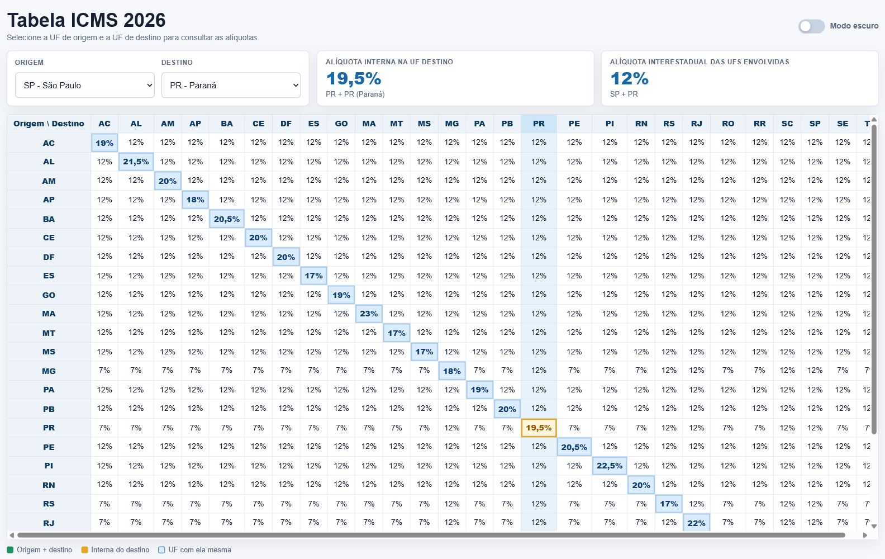
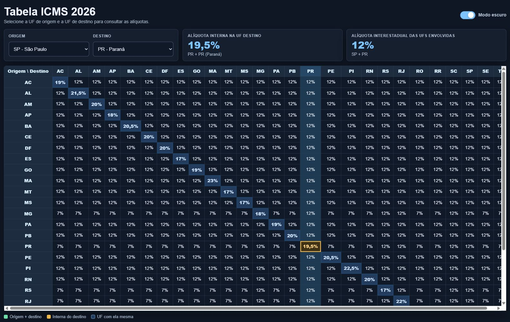
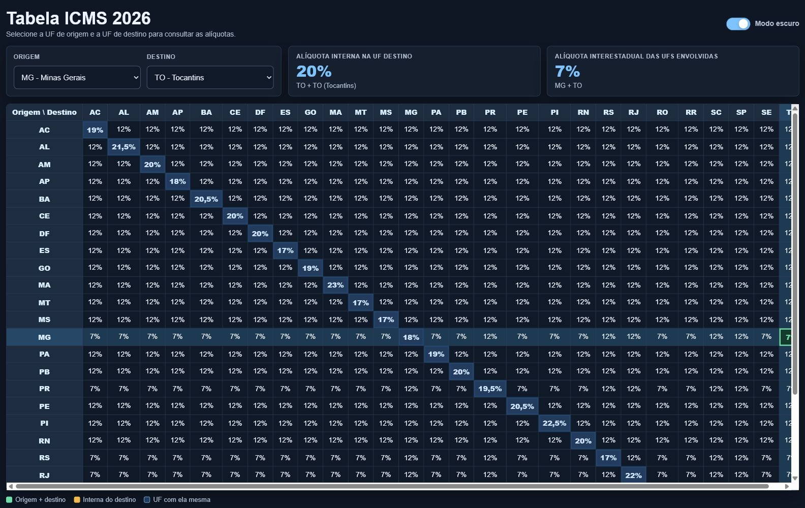

# Calculadora ICMS 2026

Pagina web para consultar aliquotas de ICMS entre UFs brasileiras.

## Funcionalidades

- Consulta por UF de origem e UF de destino.
- Exibe a aliquota interestadual das UFs selecionadas.
- Exibe a aliquota interna da UF de destino.
- Mostra a matriz completa de ICMS 2026.
- Destaca a diagonal UF + UF, a combinacao consultada e a interna do destino.
- Inclui modo claro e modo escuro.

## Prints







## Como usar

Abra o arquivo `index.html` no navegador.

Tambem e possivel servir a pasta localmente:

```bash
python -m http.server 8765
```

Depois acesse `http://127.0.0.1:8765`.
